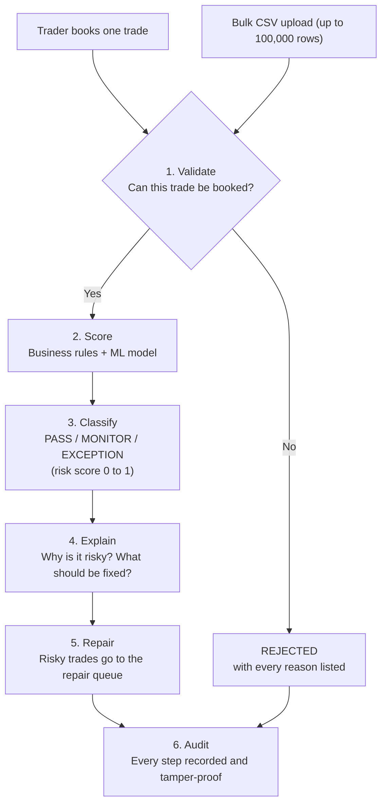
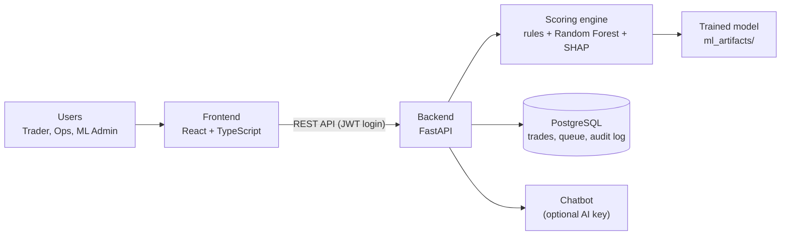

# Trade Perfect

> **Catch failing trades before they fail.**
> Trade Perfect checks every trade the moment it is booked, predicts whether it will fail to settle, explains why, and tells the operations team exactly how to fix it.

Built by **Team 33** for the **BNP Paribas Innoversité 2026-27 hackathon** (Mumbai).

---

## Why we built this

When a trade **fails settlement**, the cash or securities don't change hands on the agreed date. Someone in operations then has to find the problem, chase the counterparty and fix it by hand, and the bank pays for every day of delay.

Most of these failures come from a small set of familiar causes: a wrong or inactive account, an unknown symbol, settlement instructions (SSI) that don't match, a risky counterparty, or an unusual quantity. Today's checks only look for empty fields. They don't tell you which *valid-looking* trade is about to go wrong.

Trade Perfect does. It catches the hard errors instantly, scores the risk of everything else, and puts the risky trades in front of the right person with a ready-made fix.

---

## How it works



### What you get

| Feature | In plain words |
|---|---|
| **Trade booking** | Book a trade in a form or upload a file. Every field error is shown at once, so you fix everything in one go. |
| **Risk score** | Each trade gets a score from 0 (safe) to 1 (likely to fail), with the reasons as percentages. |
| **Dashboard** | Counts and charts of today's trades and all trades, by status. |
| **Repair queue** | Risky trades are assigned to operations users, who apply a fix, re-submit or reject them. |
| **Audit trail** | A timeline for every trade, a PDF report, and a check that proves nobody edited the log. |
| **Model monitoring** | Model quality, data drift, retraining, and switching to a new model without a restart. |
| **Chatbot** | Ask things like *"How many times did settlement fail for BlackRock?"* |

---

## How the pieces fit together



The scoring engine is a plain Python library with no database or web code inside. The backend hands it trades, gets back scores and explanations, and saves them. That separation is what let our team build the frontend, backend and ML parts at the same time.

---

## Project status

| Part | Status |
|---|---|
| **Scoring engine + ML model** | Done |
| **Backend API** (62 endpoints) | Done, 1,022 automated tests passing |
| **Frontend** | Login works against the real backend; the other screens are in progress |
| **Deployment** | Prepared, not deployed yet (see [backend/README.md](backend/README.md)) |

Until all frontend screens are finished, every feature can be tried through the API's built-in test page (Swagger) at http://localhost:8000/docs.

---

## Run it on your computer

You need:
- **Docker Desktop**, for the backend and the database
- **Node.js 22 or newer**, for the frontend

### 1. Start the backend and database

Copy the example settings file.

Mac / Linux:
```bash
cp .env.example .env
```

Windows:
```bash
copy .env.example .env
```

Open `.env` and replace every `CHANGE_ME` value. Then start everything:

```bash
docker compose up --build
```

The first start takes a few minutes. It creates the database, loads the reference data and 50,000 historical trades, and loads the model. When it's ready:

- API test page: http://localhost:8000/docs
- Health check: http://localhost:8000/api/v1/health should show `{"status":"ok","db":"ok","model":"v1"}`

### 2. Start the frontend

In a second terminal:

```bash
cd frontend
cp .env.example .env
npm install
npm run dev
```

(On Windows, use `copy` instead of `cp`.) Then open http://localhost:5173 and sign in.

### Demo users

Every demo user has the same password: the value of `SEED_DEFAULT_PASSWORD` in your `.env`.

| Role | Username | What they can do |
|---|---|---|
| Trader | `priya.sharma` (and 14 others, `firstname.lastname`) | Book trades, upload files, see their own trades |
| Operations User | `ops.user1`, `ops.user2`, `ops.user3` | Work on repair queue items assigned to them |
| Operations Manager | `ops.manager` | See everything, assign work, approve high-risk fixes |
| ML Admin | `ml.admin` | Monitor the model, retrain, promote, tune weights |
| System Admin | `sys.admin` | Everything, plus users and system settings |

---

## Try it in five minutes

Open http://localhost:8000/docs. To act as a user: call `POST /api/v1/auth/login`, copy the `accessToken`, click **Authorize** and paste it.

1. **As `sys.admin`**, set the demo date so the sample file is scored realistically:
   `PUT /api/v1/admin/config/business_date_override` with body `{"value": "2026-09-28"}`
2. **As `priya.sharma`**, upload `data/Trade_Dataset_20K.csv` with `POST /api/v1/trades/bulk`. Copy the `batchId` and watch progress with `GET /api/v1/uploads/{batchId}`. It takes about 40 seconds.
3. **As `ops.manager`**, open `GET /api/v1/dashboard/summary` for the counts, then `GET /api/v1/repair-queue` for the risky trades.
4. Assign one item to `ops.user1` with `POST /api/v1/repair-queue/assign`.
5. **As `ops.manager`**, ask the chatbot with `POST /api/v1/chat`:
   `{"sessionId": "demo", "message": "How many times did settlement fail for BlackRock?"}`

**What you should see for the 20,000-row file:** about 9,500 PASS, 5,500 MONITOR, 4,200 EXCEPTION, and exactly **704 REJECTED**.

---

## How a trade is scored

### Step 1: Hard checks
A trade is **REJECTED** straight away if it can't be booked, for example when:
- the symbol or counterparty isn't in the master data
- the account doesn't exist or is inactive
- the quantity or price isn't a positive number
- the trade ID is missing or already used
- the settlement date is before the trade date

### Step 2: Business rules
Each rule that applies adds to the rule score:

| Rule | Adds |
|---|---|
| Settlement instructions (SSI) not matched | 0.35 |
| Currency not matched | 0.15 |
| Settlement date in the past, on a weekend or holiday, or more than 15 days away | up to 0.15 |
| Counterparty risk tier (based on its history of failures) | 0 to 0.25 |
| Quantity above 5,000 or below 100 | 0.10 or 0.05 |

### Step 3: Machine-learning model
A **Random Forest** trained on 50,000 historical trades estimates the probability that the trade fails. **SHAP** shows which inputs pushed that probability up.

### Step 4: Final score and status

```
final score = 0.3 × model score + 0.7 × rule score
```

| Final score | Status | Priority | What happens next |
|---|---|---|---|
| below 0.5 | PASS | Low | Can be re-submitted in bulk |
| 0.5 to 0.7 | MONITOR | Medium | Reviewed, then re-submitted |
| 0.7 and above | EXCEPTION | High | Must be fixed or rejected |

An admin can change every weight and limit without touching the code.

### Model quality

| Measure | Result | Target | |
|---|---|---|---|
| AUC-ROC | 0.959 | at least 0.90 | ✅ |
| Precision | 0.973 | at least 0.70 | ✅ |
| Recall | 0.879 | at least 0.85 | ✅ |
| F1 | 0.924 | at least 0.77 | ✅ |
| Accuracy | 0.903 | above 0.90 | ✅ |
| False positive rate | 0.0496 | below 0.05 | ✅ |

The full story is in [docs/ML_MODEL_REPORT.md](docs/ML_MODEL_REPORT.md).

---

## Built with

| Part | Technology |
|---|---|
| Frontend | React 18, TypeScript, Ant Design, Vite |
| Backend | Python 3.11, FastAPI, SQLAlchemy |
| Database | PostgreSQL 16 |
| Machine learning | scikit-learn (Random Forest), SHAP, pandas |
| Reports | reportlab (PDF) |
| Local setup | Docker Compose |

---

## Folder guide

```
backend/              The API
  app/api/            Web endpoints
  app/services/       Business logic
  app/engine/         Validation, rules, ML model, explanations, drift
  app/chat/           Chatbot
  ml_artifacts/       The trained model and its report
  scripts/            Load demo data, register a model
  tests/              Automated tests
frontend/             The web application
data/                 Provided files: 50K historical trades, 20K demo trades, reference data
docs/                 Model report
notebooks/            Data exploration and model experiments
schema.sql            The database structure
docker-compose.yml    Starts the database and the backend
```

---

## Tests

```bash
docker compose exec backend pytest
```

**1,022 tests pass.** They run on a separate test database, so they never touch your demo data. Among other things, they check every endpoint against every role, every allowed and forbidden step in the repair queue, and that the audit log can't be edited.

Frontend tests:
```bash
cd frontend
npm test
```

---

## Good to know

- **No e-mail server or AI key is needed.** Without e-mail settings, reports are saved and the e-mail is just logged. Without an AI key, the chatbot answers with built-in rules.
- **`.env` holds passwords and is never committed.** Use `.env.example` as the template.
- **The demo date matters.** If you skip step 1 of the walkthrough, trades that settle before today are flagged as "settlement date in the past".
- **Large uploads need memory.** A 20,000-row upload with the model uses about 730 MB. Read [backend/README.md](backend/README.md) before deploying to a small server.

---

## More documentation

| Document | What's in it |
|---|---|
| [backend/README.md](backend/README.md) | Backend commands, settings, deployment steps, measured performance |
| [PROJECT_CONTEXT.md](PROJECT_CONTEXT.md) | The full specification: rules, API contract, roles, assumptions |
| [PROGRESS.md](PROGRESS.md) | What was built in each step, decisions and open questions |
| [docs/ML_MODEL_REPORT.md](docs/ML_MODEL_REPORT.md) | How the model was trained and evaluated |
| [schema.sql](schema.sql) | Every database table |

---

## The team

| Name | Role |
|---|---|
| Mradul Jain | ML & scoring engine |
| Yash Sukheja | Backend & APIs |
| Lakshya Chanchlani | Frontend & ML validation |
| Gaurav Kumar Chaudhary | Frontend |
| Harshika Kumari | Frontend & presentation |